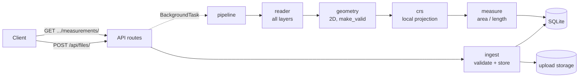
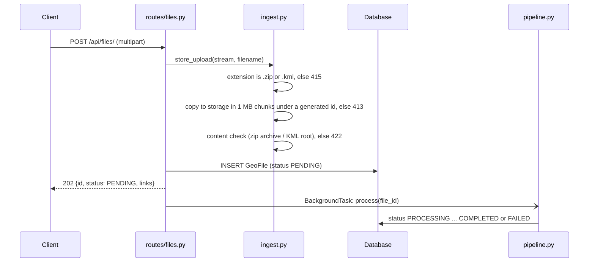

# Geospatial File Measurement API

[](https://github.com/Akshay-S-31/geospatial-measurement-api/actions/workflows/ci.yml)

A FastAPI service that accepts a zipped Shapefile or a KML file, extracts every feature, and returns
its measurements: area and perimeter for polygons, length for lines. Nothing is ever measured in
degrees or in Web Mercator. Each feature is projected to its own local equal-area or equidistant
projection. Area then matches geodesic values to within 0.0001 % at any latitude, length to within
0.002 % for features up to 1 degree across, and every measurement reports the projection it used.

## Contents

- [Quick start](#quick-start)
- [API](#api)
- [Architecture](#architecture)
- [Design decisions](#design-decisions)
- [Testing](#testing)
- [Assumptions and limitations](#assumptions-and-limitations)
- [Learnings](#learnings)
- [Future scope](#future-scope)

## Quick start

### Docker

```bash
docker compose up --build
```

### Local (Python 3.11+)

```bash
python -m venv .venv && source .venv/bin/activate
pip install -e ".[dev]"
uvicorn app.main:app --reload
```

Either way the API is at <http://localhost:8000> and the interactive docs are at
<http://localhost:8000/docs>. No system GDAL is needed: the pyogrio, shapely and pyproj wheels bundle
GDAL, GEOS and PROJ.

### Try it

```bash
# 1. Upload. The response is 202 with the file id; processing continues in the background.
curl -s -X POST http://localhost:8000/api/files/ -F "file=@samples/kochi_plots.zip"

# 2. Poll until "status" is COMPLETED (or FAILED). Replace <id> with the id from step 1.
curl -s http://localhost:8000/api/files/<id>/

# 3. Fetch the measurements.
curl -s "http://localhost:8000/api/files/<id>/measurements/"
```

Sample files in [samples/](samples/), regenerated by `python scripts/make_samples.py`:

| File | What it shows |
|---|---|
| `kochi_plots.zip` | Shapefile in UTM zone 43N (EPSG:32643): four parcels with attributes, one with a hole |
| `survey.kml` | KML with two folders (two polygons; two lines and a point) and altitudes |
| `no_prj_parcels.zip` | Shapefile without a `.prj`: the CRS is assumed and flagged |

### Configuration

Settings are read from environment variables or a `.env` file (see [.env.example](.env.example)).

| Variable | Default | Purpose |
|---|---|---|
| `DATABASE_URL` | `sqlite:///./data/app.db` | Database location |
| `STORAGE_DIR` | `./data/uploads` | Raw uploads and temporary extraction folders |
| `MAX_UPLOAD_MB` | `50` | Upload size cap; larger uploads get 413 |
| `MAX_UNZIPPED_MB` | `500` | Cap on a zip's total uncompressed size (zip-bomb guard) |
| `LOG_LEVEL` | `INFO` | Log level |
| `DENSIFY_MAX_SEGMENT_DEG` | `0.01` | Longest edge left undensified before projecting geographic geometries |

## API

| Method | Path | Purpose |
|---|---|---|
| `POST` | `/api/files/` | Upload a `.zip` (Shapefile) or `.kml`; returns 202 |
| `GET` | `/api/files/{id}/` | File information and processing status |
| `GET` | `/api/files/{id}/measurements/` | Per-feature measurements and a file summary |
| `GET` | `/api/files/` | List files, newest first |
| `DELETE` | `/api/files/{id}/` | Delete a file, its features and its stored upload |
| `GET` | `/health` | Database check, GDAL version, KML driver |

Request and response schemas with examples are in the OpenAPI docs at `/docs`. The responses below
are real output for the sample files, trimmed where noted.

### Errors

Every error, including validation errors and unknown routes, has the same body:

```json
{
  "error": {
    "code": "FILE_NOT_READY",
    "message": "File is still being processed. Try again shortly.",
    "details": { "status": "PROCESSING" }
  }
}
```

### POST /api/files/

`multipart/form-data` with a single field, `file`.

```bash
curl -i -X POST http://localhost:8000/api/files/ -F "file=@samples/kochi_plots.zip"
```

```
HTTP/1.1 202 Accepted
location: /api/files/f6437f1913e8486db38a4e35d1f4f1d7/
```

```json
{
  "id": "f6437f1913e8486db38a4e35d1f4f1d7",
  "filename": "kochi_plots.zip",
  "file_type": "SHAPEFILE",
  "status": "PENDING",
  "size_bytes": 1491,
  "created_at": "2026-10-07T16:22:44Z",
  "links": {
    "self": "/api/files/f6437f1913e8486db38a4e35d1f4f1d7/",
    "measurements": "/api/files/f6437f1913e8486db38a4e35d1f4f1d7/measurements/"
  }
}
```

The upload is rejected immediately when the file itself is unacceptable:

| Status | `code` | When |
|---|---|---|
| 413 | `FILE_TOO_LARGE` | Larger than `MAX_UPLOAD_MB` |
| 415 | `UNSUPPORTED_FILE_TYPE` | Extension is not `.zip` or `.kml` (case-insensitive; `.kmz` is not supported) |
| 422 | `EMPTY_FILE` | Zero bytes |
| 422 | `INVALID_ZIP` | `.zip` that is not a zip archive |
| 422 | `INVALID_KML` | `.kml` that is not well-formed XML with a `kml` root element |
| 422 | `VALIDATION_ERROR` | The `file` field is missing |

Problems found later, while the content is processed, do not fail the upload. They set the file's
status to `FAILED` with one of these codes in its `error`: `NO_SHAPEFILE`, `SHAPEFILE_INCOMPLETE`,
`ZIP_UNSAFE_PATH`, `ZIP_TOO_LARGE`, `NO_FEATURES`, `READ_ERROR`, `INTERNAL_ERROR`, `INTERRUPTED`.

### GET /api/files/{id}/

```bash
curl -s http://localhost:8000/api/files/b1e572d6d7744b2f929066ca93d3beb5/
```

```json
{
  "id": "b1e572d6d7744b2f929066ca93d3beb5",
  "filename": "survey.kml",
  "file_type": "KML",
  "status": "COMPLETED",
  "feature_count": 5,
  "crs": "EPSG:4326",
  "crs_assumed": false,
  "had_z": true,
  "layers": [
    { "name": "Fields", "feature_count": 2, "crs": "EPSG:4326", "error": null },
    { "name": "Roads", "feature_count": 3, "crs": "EPSG:4326", "error": null }
  ],
  "warnings": ["Z coordinates were dropped; measurements are 2D (planimetric)."],
  "error": null,
  "size_bytes": 1517,
  "created_at": "2026-10-07T16:22:44Z",
  "processed_at": "2026-10-07T16:22:44Z",
  "processing_ms": 15,
  "links": {
    "self": "/api/files/b1e572d6d7744b2f929066ca93d3beb5/",
    "measurements": "/api/files/b1e572d6d7744b2f929066ca93d3beb5/measurements/"
  }
}
```

- `status` is `PENDING`, `PROCESSING`, `COMPLETED` or `FAILED`.
- `crs` is the source CRS when all layers agree, `"MIXED"` when they differ, and `null` when unknown.
- `crs_assumed` is `true` when a shapefile had no `.prj` and EPSG:4326 was assumed. For
  `samples/no_prj_parcels.zip` the file reports `"crs_assumed": true` and the warning
  `"no_prj_parcels: No .prj found; coordinates look geographic, assumed EPSG:4326."`
- When `status` is `FAILED`, `error` holds the reason, for example
  `{ "code": "NO_SHAPEFILE", "message": "The zip archive does not contain a .shp file." }`.

Errors: `404 FILE_NOT_FOUND`.

### GET /api/files/{id}/measurements/

| Parameter | Type | Default | Notes |
|---|---|---|---|
| `limit` | int | 100 | 1 to 1000 |
| `offset` | int | 0 | 0 or more |
| `geometry_type` | string | none | Exact match, e.g. `Polygon`, `MultiPolygon`, `LineString`, `Point` |
| `include_geometry` | bool | true | `false` leaves the `geometry` key out for lighter responses |

```bash
curl -s "http://localhost:8000/api/files/f6437f1913e8486db38a4e35d1f4f1d7/measurements/?limit=1"
```

```json
{
  "file_id": "f6437f1913e8486db38a4e35d1f4f1d7",
  "crs": "EPSG:32643",
  "summary": {
    "feature_count": 4,
    "measured_count": 4,
    "unmeasured_count": 0,
    "total_area_m2": 157864.409,
    "total_length_m": 0.0,
    "count_by_geometry_type": { "Polygon": 4 }
  },
  "pagination": { "limit": 1, "offset": 0, "total": 4, "next_offset": 1 },
  "features": [
    {
      "index": 0,
      "layer": "kochi_plots",
      "geometry_type": "Polygon",
      "source_crs": "EPSG:32643",
      "properties": {
        "plot_id": "KCH-001",
        "owner": "A. Menon",
        "land_use": "residential",
        "surveyed": "2026-09-14"
      },
      "geometry_repaired": false,
      "geometry": {
        "type": "Polygon",
        "coordinates": [
          [[76.261, 9.931], [76.2618, 9.9311], [76.2617, 9.9318], [76.2609, 9.9317], [76.261, 9.931]]
        ]
      },
      "measurement": {
        "kind": "area",
        "area_m2": 6913.787,
        "perimeter_m": 333.244,
        "length_m": null,
        "method": "LAEA",
        "projected_crs": "+proj=laea +lat_0=9.9 +lon_0=76.3 +datum=WGS84 +units=m +no_defs"
      },
      "reason": null
    }
  ]
}
```

A line from `samples/survey.kml` has `"kind": "length"`, `"length_m": 1719.532` and
`"method": "AEQD"`. A point is returned without a measurement, and says why:

```json
{
  "index": 4,
  "layer": "Roads",
  "geometry_type": "Point",
  "source_crs": "EPSG:4326",
  "properties": { "Name": "Control point GCP-1", "description": "Ground control point" },
  "geometry_repaired": false,
  "geometry": { "type": "Point", "coordinates": [76.3035, 10.019] },
  "measurement": null,
  "reason": { "code": "NOT_MEASURABLE", "message": "Points have no area or length." }
}
```

(The KML driver also reports its `tessellate`, `extrude` and `visibility` fields in `properties`;
they are left out above.)

What each field means:

- `index` is 0-based and global across the file: layer order, then feature order. It is stable
  between runs.
- `geometry` is GeoJSON in **EPSG:4326** whatever the source CRS was, as RFC 7946 requires.
  `source_crs` says what the file used.
- `area_m2`, `perimeter_m` and `length_m` are in square metres and metres, rounded to 3 decimals in
  the response and stored at full precision.
- `method` and `projected_crs` name the projection behind the headline value: LAEA for area, AEQD
  for length. A polygon's perimeter is measured in AEQD with the same centre.
- `summary` always covers the whole file. `geometry_type` filters only `features` and
  `pagination.total`.

Features that cannot be measured are kept, with `measurement: null` and a `reason`:

| `reason.code` | When |
|---|---|
| `NOT_MEASURABLE` | Point or MultiPoint |
| `UNSUPPORTED_GEOMETRY_TYPE` | GeometryCollection that mixes geometry types |
| `EMPTY_GEOMETRY` | Missing or empty geometry (`geometry` is `null`) |
| `INVALID_GEOMETRY` | Invalid geometry with nothing measurable left after repair |
| `UNKNOWN_CRS` | Shapefile without `.prj` whose coordinates are not lon/lat |
| `MEASUREMENT_FAILED` | Coordinates outside the valid range of the declared CRS |

Errors:

| Status | `code` | When |
|---|---|---|
| 404 | `FILE_NOT_FOUND` | Unknown id |
| 409 | `FILE_NOT_READY` | Status is `PENDING` or `PROCESSING` |
| 409 | `FILE_FAILED` | Status is `FAILED`; `details.error` holds the stored reason |
| 422 | `VALIDATION_ERROR` | A query parameter is out of range |

### Other endpoints

- `GET /api/files/?limit=&offset=` returns `{ "items": [...], "pagination": {...} }` with the same
  file objects as above, newest first.
- `DELETE /api/files/{id}/` returns `204`, or `409 FILE_NOT_READY` while the file is being processed.
- `GET /health` returns
  `{ "status": "ok", "db": "ok", "gdal_version": "3.12.4", "kml_driver": "LIBKML" }`.

## Architecture

### Application structure

Three layers with one dependency direction: `api -> services -> db`. Routes only translate HTTP.
Everything else lives in `services/`, which never imports FastAPI, so it is tested without HTTP.
`crs.py` and `measure.py` are pure functions over shapely geometries, with no database and no I/O.

```
app/
├── main.py              App factory, lifespan (create tables, fail files interrupted by a restart)
├── api/
│   ├── deps.py          Settings, engine and session dependencies
│   ├── errors.py        Exception handlers that produce the uniform error body
│   └── routes/
│       ├── files.py     Upload, file info, measurements, list, delete
│       └── health.py    GET /health
├── core/
│   ├── config.py        Settings (pydantic-settings)
│   ├── errors.py        AppError, ProcessingError and error codes; no framework imports
│   └── logging.py       key=value logs with the file id on every processing line
├── db/
│   ├── models.py        SQLModel tables: GeoFile, Feature
│   └── session.py       Engine and table creation
├── schemas/             Response models (files, measurements, pagination, errors)
└── services/
    ├── ingest.py        Validate and store uploads; zip-slip and zip-bomb safe extraction
    ├── reader.py        Read every layer with pyogrio; resolve each layer's CRS
    ├── geometry.py      Drop Z, repair invalid geometry, JSON-safe attributes, GeoJSON output
    ├── crs.py           Projection choice, densification, cached transformers
    ├── measure.py       Area, perimeter and length for one geometry
    ├── reasons.py       Coded reasons for unmeasured features
    ├── pipeline.py      Orchestrates one processing run and its status transitions
    └── repository.py    Database reads and writes, bulk insert, SQL aggregates
tests/                   Unit and API tests; all fixtures are generated in code
samples/                 Three small files to try with curl
scripts/                 make_samples.py, projection_accuracy.py
```



### File-processing flow

The upload request does only the cheap, synchronous part and returns `202`:



The background task (`pipeline.process`) runs in a worker thread with its own database session:

1. Set the status to `PROCESSING`.
2. Shapefile: extract the zip safely. Every member is checked before anything is written: paths
   that leave the target directory, absolute paths and symlinks are rejected, the total uncompressed
   size is capped, and `__MACOSX` and hidden files are skipped. Each `.shp` becomes a layer.
   KML: every `<Folder>` becomes a layer.
3. Read each layer with pyogrio into a GeoDataFrame and resolve its CRS. A layer that cannot be read
   (for example a `.shp` without its `.shx` or `.dbf`) is recorded with its error and skipped.
4. For each feature, in a stable order: drop Z, repair invalid geometry with `make_valid`, measure
   it, convert its attributes to JSON-safe values and its geometry to WGS84 GeoJSON.
5. Insert the features in batches inside one transaction, then store the file's CRS, layers,
   warnings and timings and set the status to `COMPLETED`.

Problems are contained at the smallest scope possible. A bad feature gets a `reason`, a bad layer
gets an `error`, and only a file-level problem (unsafe zip, no shapefile, no readable layer, no
features) sets the file to `FAILED`. Unexpected exceptions are logged with their traceback and
reported as `INTERNAL_ERROR`; no stack trace reaches the API.

### Measurement calculation flow

For one geometry in its source CRS (`measure.measure`):

1. **Decide what to measure.** Polygon and MultiPolygon get area and perimeter; LineString,
   MultiLineString and LinearRing get length. Anything else returns a reason instead.
2. **Densify in the source CRS** so no edge is longer than 0.01 degree (geographic sources) or 1 km
   (projected sources, converted to the source's own unit, so files in feet work).
3. **Reproject to WGS84 lon/lat**, unless the source already is WGS84.
4. **Pick the projection centre**: the feature's centroid, rounded to 0.1 degree.
5. **Project and measure.** Area is the planar area in a Lambert Azimuthal Equal-Area (LAEA)
   projection on that centre. Perimeter and length are the planar length in an Azimuthal
   Equidistant (AEQD) projection on the same centre.
6. **Report** the values with `method` and the exact PROJ string, for example
   `+proj=laea +lat_0=9.9 +lon_0=76.3 +datum=WGS84 +units=m +no_defs`.

Two details matter for correctness:

- Densification comes before reprojection. An edge is a straight line in the CRS it was drawn in;
  projecting only its end points replaces it with a straight line in the target projection, which is
  a different curve on the ground. For a square 5 degrees across at 45 N, skipping this step shifts
  the area by 0.10 %.
- Transformers are always built with `always_xy=True`. EPSG:4326 is officially latitude-first, and
  without the flag pyproj reads shapely's (x, y) as (lat, lon).

### CRS handling

Coordinates in EPSG:4326 are angles. One degree of longitude is about 111 km at the equator and
about 56 km at 60 N, so an area computed on lon/lat is in "square degrees" and means nothing.
Reprojecting to any metric CRS is not enough either, because each projection distorts something:

| Projection | Preserves | Problem for measurement |
|---|---|---|
| Web Mercator (EPSG:3857) | Angles | Area is inflated by 1/cos²(latitude) |
| UTM zone | Angles | Area off by up to about 0.2 % inside the zone; unusable across zones and beyond 84 N / 80 S |
| Lambert Azimuthal Equal-Area | Area, everywhere | Shape distorts away from the centre, which does not affect area |
| Azimuthal Equidistant | Distance from the centre | Length error grows with the square of the distance from the centre |

So the service builds a projection per feature, centred on the feature, and chooses it by what is
measured: LAEA for area, AEQD for length and perimeter. Both use the WGS84 ellipsoid, not a sphere.

Area error of a 0.1 x 0.1 degree square against the geodesic area from `pyproj.Geod`
(reproduce with `python scripts/projection_accuracy.py`):

| Latitude | Local LAEA (this service) | UTM zone 43N | Web Mercator |
|---|---|---|---|
| 0 | 0.0000 % | -0.011 % | +0.67 % |
| 10 (Kerala) | 0.0000 % | -0.013 % | +3.8 % |
| 45 | 0.0000 % | -0.046 % | **+100 %** |
| 60 | 0.0000 % | -0.063 % | **+299 %** |
| 85 | 0.0000 % | -0.080 % (outside UTM's range) | **+12,978 %** |

The squares sit 1.5 degrees east of the UTM zone's central meridian. UTM error depends on that
distance: it is -0.08 % on the central meridian and reaches about +0.18 % at the zone edge near the
equator.

Length and perimeter with local AEQD, by feature size, at latitude 10. The line follows two sides
of the square, so it does not pass through the projection centre:

| Feature size | Perimeter error | Line length error | Area error |
|---|---|---|---|
| 0.1 degree (about 11 km) | 0.0000 % | 0.0000 % | 0.0000 % |
| 1 degree (about 111 km) | +0.0012 % | +0.0005 % | 0.0000 % |
| 5 degrees (about 555 km) | +0.031 % | +0.008 % | 0.0000 % |

Rounding the projection centre to 0.1 degree lets neighbouring features share one cached
transformer. It costs no accuracy: LAEA is equal-area whatever its centre, and moving an AEQD centre
by at most 0.05 degree (about 5.5 km) changes a length by far less than the figures above.

How the source CRS is resolved before measuring:

| Case | Behaviour |
|---|---|
| Layer has a CRS (from the `.prj`) | Use it. Reported as `EPSG:xxxx`, or by name if it has no EPSG code |
| KML | Always EPSG:4326, as the OGC KML specification defines |
| Shapefile without `.prj`, all coordinates within lon/lat bounds | Assume EPSG:4326, set `crs_assumed: true`, add a warning |
| Shapefile without `.prj`, coordinates outside lon/lat bounds | CRS unknown: features are kept with reason `UNKNOWN_CRS`, the file still completes with a warning |
| Source is already projected (UTM, State Plane, Web Mercator, ...) | Same path as everything else: source -> WGS84 -> local LAEA/AEQD. It is never measured in place |

## Design decisions

**FastAPI over Django + DRF.** The service has a handful of endpoints, no admin UI, no auth and two
tables. FastAPI gives request validation and OpenAPI docs from Pydantic models, and its
`BackgroundTasks` cover asynchronous processing at this scale. Django would bring an admin, a mature
ORM and migrations, none of which this needs, and would call for Celery sooner. The cost is no
built-in migrations, which is acceptable with `create_all` and two tables.

**Per-feature local LAEA and AEQD projections.** The brief forbids measuring in degrees and leaves
the projected CRS open. Alternatives considered:

- *Web Mercator*: rejected. +100 % area error at 45 degrees, +3.8 % even in Kerala.
- *UTM zone from the centroid*: the standard answer and a solid runner-up, but up to 0.2 % off
  depending on the distance from the central meridian, undefined near the poles, and awkward for
  features that straddle two zones.
- *One global equal-area CRS (EPSG:6933)*: exact area, but its length distortion away from the
  standard parallels rules it out for lines.
- *Geodesic maths (`pyproj.Geod`)*: the most accurate, but it does not reproject at all, and the
  brief asks for a projected CRS. It is the ground truth in the tests instead.

The result is exact area at any latitude and length error under 0.002 % for features up to
1 degree across, with the PROJ string reported for transparency.

**One pipeline for every source CRS.** Even a source that is already projected goes
source -> WGS84 -> local projection. "Projected" does not mean "fit for measurement": the source may
be Web Mercator. One code path is simpler to test and gives every input the same accuracy; the extra
transform costs microseconds.

**Asynchronous processing with `BackgroundTasks`.** `POST` returns `202` and clients poll the file.
Processing inside the request would be simpler but ties up the connection and times out on large
files; Celery with Redis would be durable and scalable but adds two services to a small project.
The trade-off is that a task is lost if the process dies, so on startup any file left unfinished is
marked `FAILED` with `INTERRUPTED`. `pipeline.process(file_id, engine, settings)` does not depend on
FastAPI, so moving it to a task queue changes only the line that schedules it.

**SQLite with SQLModel; one row per feature.** Persisting each feature as a row, rather than one
JSON blob per file, gives real pagination, filtering by geometry type and SQL aggregates for the
summary. Geometry is stored as GeoJSON text because nothing is queried by location, which is what
would justify PostGIS. SQLite needs no setup; `DATABASE_URL` can point at PostgreSQL instead.

**geopandas + pyogrio for reading.** One GDAL-backed reader handles both formats, and its native
libraries ship inside the wheels. For KML the LIBKML driver is used when present, because it exposes
each `<Folder>` as a layer. Fiona is the older, slower engine; `fastkml` or hand-written XML parsing
would re-implement GDAL and miss edge cases; `pyshp` reads only shapefiles.

**Degrade gracefully instead of failing.** Per-feature problems produce `measurement: null` with a
coded reason, per-layer problems are recorded on the layer, and only file-level problems fail the
file. Real-world files are imperfect, and the brief asks for unsupported geometries to be handled
"gracefully rather than crashing".

**Geometry is returned in EPSG:4326.** RFC 7946 defines GeoJSON in WGS84 and web maps consume it
directly. Returning source-CRS coordinates would be misplaced by GeoJSON clients; `source_crs` is
reported alongside instead.

**Never guess a CRS silently.** A shapefile without `.prj` is assumed to be EPSG:4326 only if every
coordinate fits lon/lat bounds, and the assumption is visible in `crs_assumed` and a warning.
Otherwise nothing is measured.

**Transformers are cached per thread.** Building a pyproj transformer costs about a millisecond, so
they are cached by CRS pair. Files are processed in a thread pool and a PROJ context must not be
used from two threads at once, so the thread id is part of the cache key.

## Testing

```bash
pytest -q                                         # 148 tests, about 2 seconds
pytest -q --cov=app --cov-report=term-missing     # 98 % line coverage
ruff check . && ruff format --check .
```

CI runs lint, the format check and the tests with coverage on Python 3.11 and 3.12 for every push
and pull request.

**Correctness is tested against independent ground truth.** `pyproj.Geod` integrates directly on
the WGS84 ellipsoid and uses no projection, so it shares no code path with the service. The tests
require agreement within 0.01 %:

- area of a square at latitudes -85, -60, -30, 0, 10, 45, 60 and 85;
- the same ground polygon supplied in EPSG:4326, UTM 43N and Web Mercator gives one area;
- polygons with holes, MultiPolygons, bent lines, MultiLineStrings, perimeters;
- a source in US survey feet (EPSG:2227);
- an axis-order regression test, and a "degree trap" test that a 0.01 degree square is about
  1.2 km², not 0.0001 square degrees.

Other areas covered:

- **Security**: zip-slip, absolute paths and symlinks in archives, the uncompressed-size cap, an XML
  entity-expansion payload, and that the client's filename is never used as a path.
- **Reading**: multi-folder KML, columns the KML driver adds but never fills, missing `.prj` in both
  variants, mixed CRSs, nested folders, missing sidecar files, corrupt shapefiles.
- **Pipeline**: the status lifecycle, repaired and collapsed geometries, a feature that raises
  unexpectedly, restart recovery, and 10,000 features in well under the 30 second budget.
- **API**: every endpoint, every documented error code in the uniform error body, pagination,
  filtering, `include_geometry=false`, and the three sample files.

No binary fixtures are committed. Every test file is built by
[tests/fixtures/factory.py](tests/fixtures/factory.py).

Manual checks worth doing with real data:

- Draw a polygon in Google Earth or geojson.io, export it as KML, upload it, and compare with the
  tool's own measurement. Expect agreement within about 0.5 %; Google Earth measures on a sphere.
- Upload a real government shapefile, for example a state boundary in EPSG:4326 or a parcel file in
  UTM.

## Assumptions and limitations

- **Single process.** Background tasks run inside the API process and SQLite is the database. With
  several workers, startup recovery would need a real task queue instead.
- **Planimetric measurements.** Z and M values are dropped; `had_z` and a warning say so. Surface
  area over terrain is not computed.
- **Edges are straight lines in the source CRS**, densified before projecting. They are not
  geodesics between vertices.
- **Very large features.** Area stays exact at any size. Perimeter and length error grows with
  feature size: about 0.03 % for a feature 5 degrees across.
- **Antimeridian.** Features that cross 180 degrees longitude are not split, so their measurements
  may be wrong. Features wider than 180 degrees of longitude are flagged in the file's warnings.
- **Datum shifts** use PROJ's defaults; no grid-shift files are bundled. For older datums this can
  shift positions slightly, with a negligible effect on areas and lengths.
- **The missing-`.prj` heuristic** can be fooled by a local engineering grid whose coordinates
  happen to fall within lon/lat bounds. That is why the assumption is always flagged.
- **KML only, not KMZ.** A `<Placemark>` is a feature. KML attributes are reported as the GDAL
  LIBKML driver exposes them, including its `tessellate`, `extrude` and `visibility` fields.
- **The upload size cap** is enforced while the file is copied to storage. In production a reverse
  proxy should also reject oversized bodies before they reach the application.
- **No authentication.** Anyone who can reach the service can upload, read and delete.

## Learnings
<!-- TODO: 4–6 bullets covering:
     - What was surprising about projections (e.g. the Web Mercator numbers)?
     - What broke first with real KML/shapefiles?
     - What to do differently with more time? -->

## Future scope

- A durable task queue (Celery or RQ with Redis) with retries, in place of in-process background tasks.
- PostgreSQL with PostGIS: native geometry columns, spatial indexes and queries by location.
- Object storage (S3) for uploads instead of the local disk.
- Authentication, per-user ownership of files, and rate limiting.
- More formats: GeoJSON, GeoPackage, KMZ.
- Splitting features at the antimeridian before measuring.
- 3D and terrain-aware measurements: surface area and slope length using Z values or a DEM.
- A webhook on completion, so clients do not have to poll.
- An endpoint to reprocess a stored file, for example after a fix or with a user-supplied CRS for
  files without a `.prj`.
- Alembic migrations once the schema starts to change.
